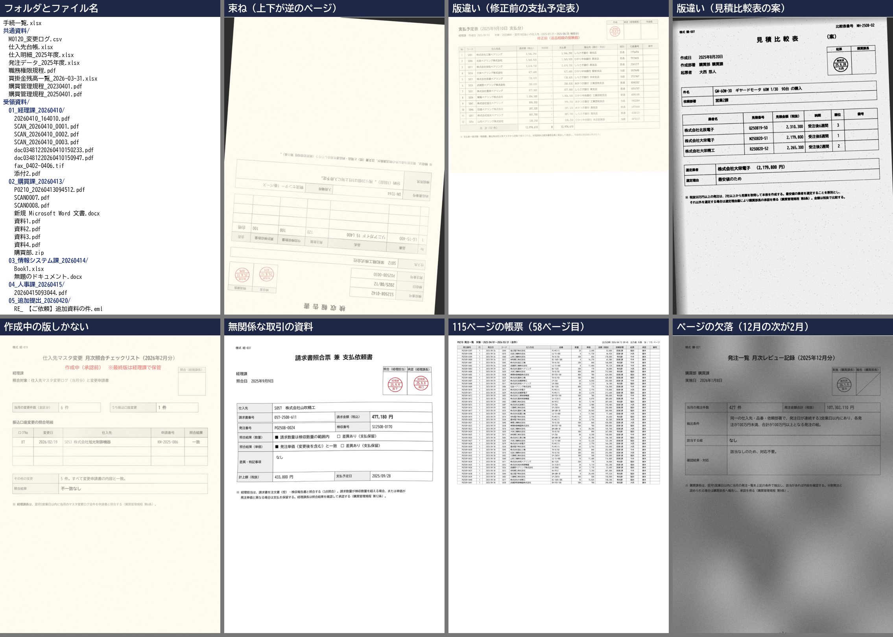

# 内部監査の手続をAIに評価させるための検証データ

内部監査の手続（証跡を見て「不備なし／不備あり／判断できない」を判定する作業）を、AIがどこまで正しく行えるかを確かめるためのテストデータです。
入力は「手続一覧（Excel）」と「証跡ファイル」、答え合わせ用に「正解表」が付いています。

**会社名・人名・取引・番号・メールアドレスは、すべて架空です。** 実在のものと一致していても関係はありません。



## 収録内容

7つの業務領域について、それぞれ「個別版」と「実務版」の2種類があります。

| 業務領域 | 手続 | 判定の単位 | 個別版の証跡ファイル | 実務版の受領ファイル |
|---|---|---|---|---|
| 販売プロセス | 13 | 56 | 76 | 17 |
| 購買プロセス | 13 | 42 | 92 | 21 |
| ITインフラ管理 | 5 | 21 | 21 | 13 |
| IT業務処理 | 5 | 19 | 25 | 10 |
| 製造プロセス | 5 | 16 | 35 | 11 |
| 実地棚卸 | 5 | 20 | 15 | 8 |
| 工事進行管理 | 5 | 16 | 31 | 11 |
| 計 | 51 | 190 | 295 | 91 |

- 「判定の単位」は、手続をサンプルや対象月ごとに分けた、正解を付ける最小の単位です。
- 証跡ファイルの数は、共通資料（規程・基準・データ）と手続一覧を除いた数です。

## 4つの版

同じ統制・取引・不備を、読みやすさと渡し方を変えて4通り用意しています。

| | 証跡1つが1ファイル（個別版） | 実務で受け取る形（実務版） |
|---|---|---|
| 読みにくい | `A_難版` | `C_実務版_難` |
| 読みやすい | `B_対照版` | `D_実務版_対照` |

- **A と B の差**：読み取りの難しさ（かすれ、傾き、FAX、写真、手書き、汚れなど）による誤り
- **A と C、B と D の差**：渡し方による誤り
- 実務版の渡し方：受領時のままのファイル名、提出元ごとのフォルダ、複数の証跡を束ねたPDF（順不同・上下逆・白紙・送付状・無関係な資料）、版違い（旧版・承認前の控）、数十〜百ページ超の資料、WordやExcelに貼り付けた画像、TIFF・ZIP・メール・CSV

手続ごとの正解の内訳（不備なし／不備あり／判断できない）は次のとおりです。

| 業務領域 | A | B | C | D |
|---|---|---|---|---|
| 販売プロセス | 6/5/2 | 7/5/1 | 5/5/3 | 5/5/3 |
| 購買プロセス | 6/5/2 | 7/5/1 | 5/5/3 | 6/5/2 |
| ITインフラ管理 | 1/3/1 | 2/3/0 | 1/3/1 | 1/3/1 |
| IT業務処理 | 1/3/1 | 2/3/0 | 1/3/1 | 1/3/1 |
| 製造プロセス | 2/2/1 | 3/2/0 | 1/2/2 | 1/2/2 |
| 実地棚卸 | 2/2/1 | 3/2/0 | 1/2/2 | 1/2/2 |
| 工事進行管理 | 2/2/1 | 3/2/0 | 1/2/2 | 1/2/2 |

## フォルダ構成

```
datasets/
  <業務領域>_検証データ_小/            個別版
    A_難版/  B_対照版/                 検証対象に渡す入力（手続一覧.xlsx、共通資料、証跡）
    正解/                              正解表.xlsx、正解.json
    README.md                          そのセットの説明（正解を含む）
    生成スクリプト（参考）/
  <業務領域>_検証データ_小_実務版/     実務版
    C_実務版_難/  D_実務版_対照/       検証対象に渡す入力（手続一覧.xlsx、共通資料、受領資料）
    正解/                              正解表_実務版.xlsx、正解.json
    README.md
    生成スクリプト（参考）/
rcm/                                   領域ごとのRCM（1シートにまとめた入力用の表）
src/                                   生成プログラム一式（参考）
docs/preview/                          各セットの見本画像
```

## RCM（1シート版）

`rcm/RCM_<業務領域>.xlsx` は、各セットの `手続一覧.xlsx`（リスクと統制・手続・サンプル・前提の4シート）を、1つのシートにまとめたものです。検証対象への入力として、手続一覧の代わりに使えます。個別版・実務版のどちらの証跡にも使えます。

| 区分 | 列 |
|---|---|
| RCM | プロセス、サブプロセス、リスクNo、リスクの内容、アサーション、統制No、統制の内容、予防／発見、実施方法、頻度、実施部署・実施者 |
| 手続 | 手続No、手続の種類、手続の内容、サンプル数、サンプル（対象） |
| 想定証跡 | 文書の種類 |
| 備考 | 手続に必要な前提（営業日の定義、金額は税抜、期限の起算日など） |

- 1手続が1行です。1〜7行目に題名と共通の前提、9〜10行目に見出し、11行目から明細があります。
- 正解につながる記載、証跡のファイル名・フォルダ名は入れていません。
- アサーション、予防／発見、実施部署・実施者は、もとの手続一覧にない項目を統制の文面から補ったものです。財務報告に直結しない統制のアサーションは「－」としています。
- `src/rcm.py` で作っています。

## 使い方

1. 版のフォルダ（例：`datasets/購買プロセス_検証データ_小/A_難版/`）を、フォルダごと検証対象に入力します。
2. 出力された判定を、同じセットの `正解/` にある正解表の「単位別の正解」と突き合わせます。
3. 実務版で誤った単位は、正解表の「所在の対応表」で、どのファイルの何ページ目を見るべきだったかを確かめます。誤りの原因を「探せなかった／読めなかった／判断を誤った」に分けられます。

手続単位の正解は、次の決め方です。

- 単位に1件でも「不備あり」があれば、手続は「不備あり」
- それ以外で1件でも「判断できない」があれば、手続は「判断できない」
- どちらもなければ「不備なし」

## 注意

- **各セットの `README.md` と `正解/` には正解が書かれています。検証対象には渡さないでください。** このページには、個々の手続の正解は書いていません（内訳の件数だけです）。
- 難版のPDFの一部は、画像と違う内容の文字情報（見えない文字の層）を持っています。文字情報だけを読むと誤る箇所を、意図して入れています。場所は各セットの `README.md` と正解表に書いてあります。
- 実務版には、パスワード付きで開けないPDFが入っているセットがあります。開けないこと自体がテストの一部です。
- 「判断できない」が正解になるのは、判定に必要な箇所が読めない、必要な証跡やページがない、承認前の版しかない、ファイルが開けない、のいずれかです。
- 個別版の正解は、証跡を作る元のデータから計算し直して突き合わせています。実務版は、すべての証跡の所在が対応表にあること、ファイルが開けること、文字情報の違いが束ねた後も残ることを確かめています。

## 生成プログラム（参考）

`src/` に、データを作ったプログラムを置いています。作成時の環境に合わせた作りのため、そのままでは動きません。動かすには次が必要です。

- Python 3 と、reportlab、pymupdf、pillow、numpy、opencv-python-headless、openpyxl、fonttools、pypdf、pdfminer.six、python-docx
- フォント7種を `fonts/` に置く：BIZ UDGothic（Regular・Bold）、BIZ UDMincho、DotGothic16、Klee One、Yomogi、Zen Kurenaido（いずれも SIL Open Font License）
- LibreOffice と、Excelの数式を再計算するスクリプト（場所を環境変数 `XLSX_RECALC` で指定）。このスクリプトは同梱していません
- 参考値のOCRには tesseract（日本語）
- `src/common.py` の `ROOT`（作業フォルダ）を環境に合わせて書き換える

| 対象 | 入口 |
|---|---|
| 販売（個別版） | `build.py` → `book.py` → `verify.py` → `pack.py` |
| 購買（個別版） | `build_p.py` → `book_p.py` → `verify_p.py` → `pack_p.py` |
| ITインフラ・IT業務処理・製造・実地棚卸・工事（個別版） | `run.py <key>`（key は itinfra / itapp / mfg / inv / const） |
| 購買（実務版） | `px_build.py` → `px_pack.py` |
| そのほかの実務版 | `r_<key>.py`（key は sales / itinfra / itapp / mfg / inv / const）。共通部分は `real.py` |

PDFに埋め込まれているフォントは、上記の7種の一部です。
